<!-- Profilseite von GitHub. Text oberhalb des Koi frei anpassen. -->
## Hallo, ich bin Johannes 

Bauingenieur aus Dortmund mit einer Schwäche fürs Programmieren.

-  **Beruf:** Bauingenieur bei der **Assmann-Gruppe** in Dortmund, dort in der Entwicklung für
  KI, Digitalisierung, Automatisierung und Programmentwicklung
-  **Studium:** Bauingenieurwesen an der Hochschule Bochum, Bachelor und Master mit Schwerpunkt
  Bauinformatik, daher kommt meine Liebe zum Programmieren
-  **Privat:** Spieleentwicklung, eigene Programme und Softwarelösungen
-  **Antrieb:** mich stetig weiterentwickeln und Neues ausprobieren

**Sprachen & Werkzeuge**

### Das ist mein Contribution-Koi

Der Koi wächst, wenn ich regelmäßig auf GitHub arbeite, und schrumpft in Pausen.
Seine Flecken zeigen die Sprachen der letzten 90 Tage. [Wie das funktioniert](docs/ANLEITUNG.md)
